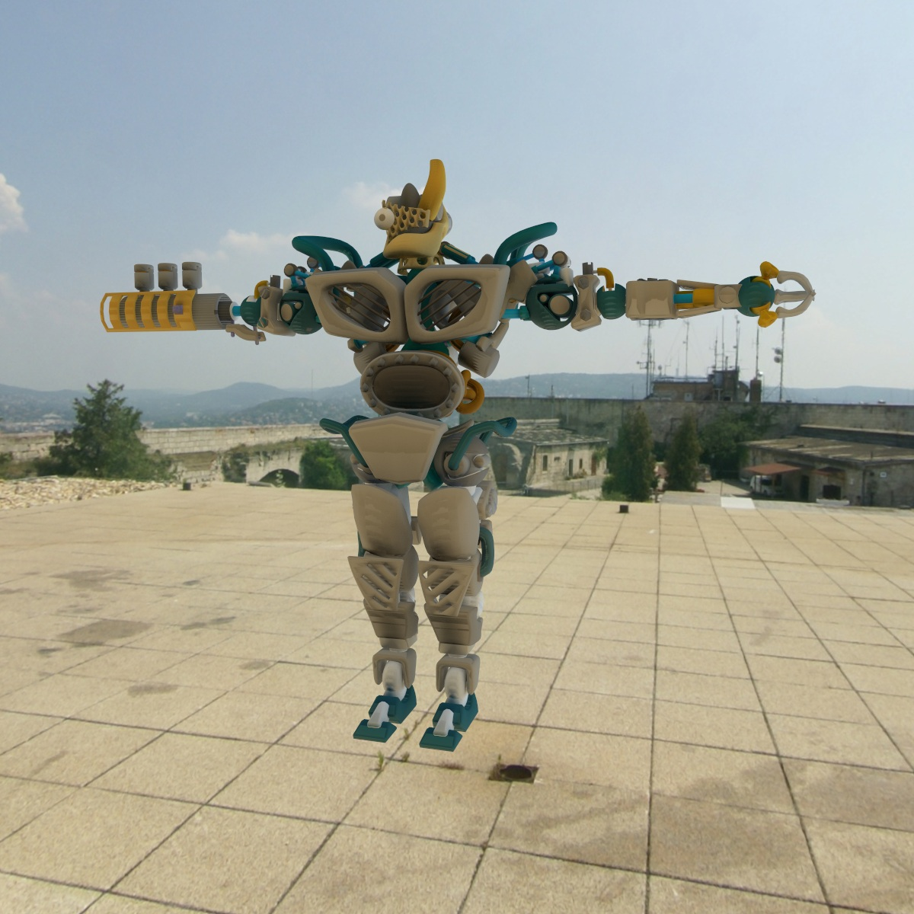
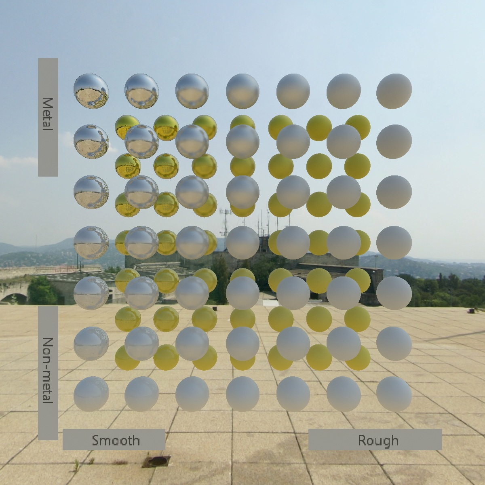
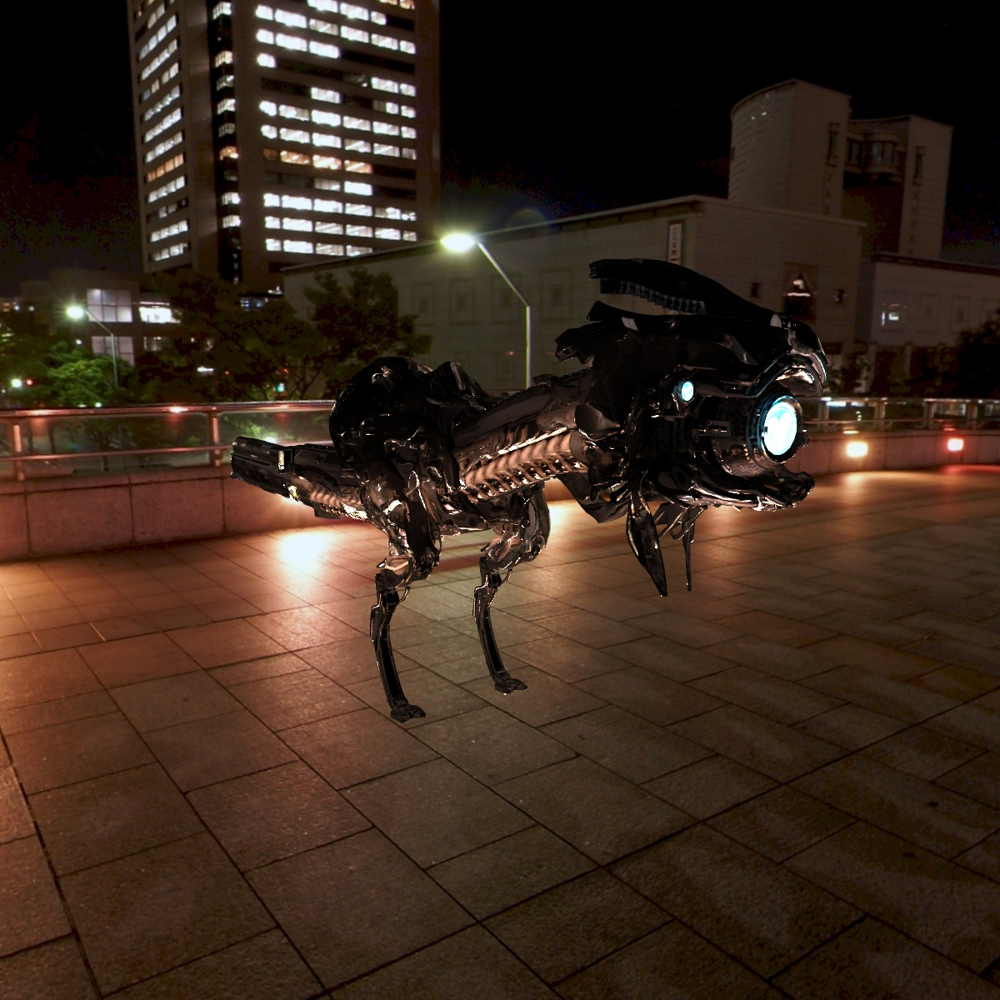
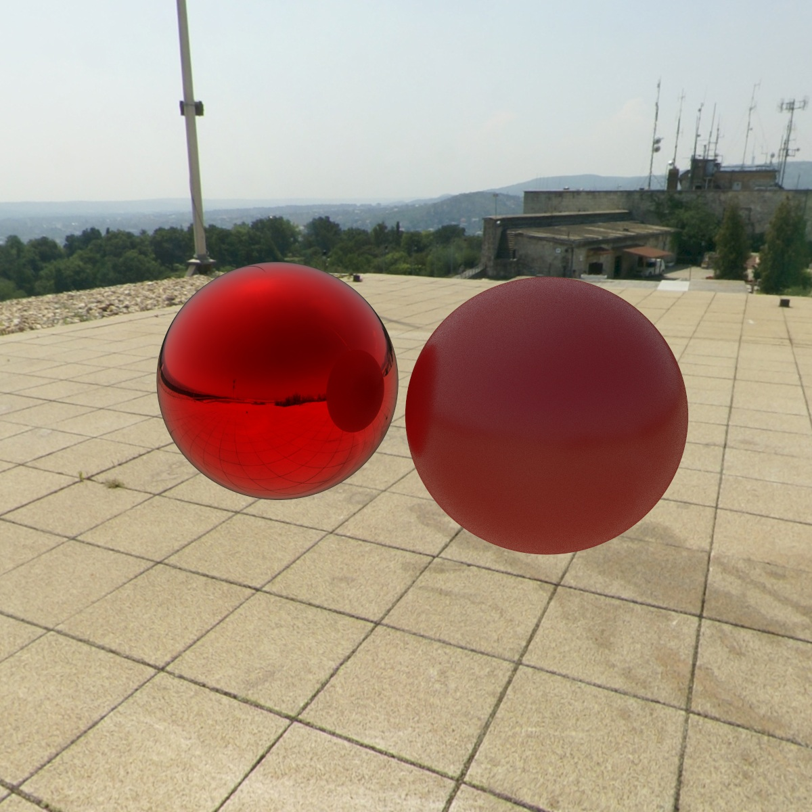

# RayTrace

## Licence

This project is public and MIT-licensed.  
Forking and cloning are welcome.  
However, this repository does not accept external pull requests.  
Please use Issues for bug reports.

## Purpose

This project was created to experiment with ray tracing and develop my C#/WPF skills.

## Features

- Multi-threaded ray tracing engine.
- Interactive scene preview.
- Basic texture editor.
- Support for importing OBJ and glTF format.
- Support for CookTorrence and glTF BRDFs, plus reflective and basic Lambertian materials.

## Samples

'Brainstem' from https://github.com/KhronosGroup/glTF-Sample-Assets/tree/main/Models/BrainStem

https://github.com/KhronosGroup/glTF-Sample-Assets/tree/main/Models/MetalRoughSpheres

This work is based on "Redeye Watcher Rig | Horizon Zero Dawn" (https://sketchfab.com/3d-models/redeye-watcher-rig-horizon-zero-dawn-610cad1a5ab340059931fc916dc8f8ce) by cherishloveart (https://sketchfab.com/cherishloveart) licensed under CC-BY-4.0 (http://creativecommons.org/licenses/by/4.0/)

Skyboxes from https://www.humus.name/index.php?page=Textures. Licensed under a Creative Commons Attribution 3.0 Unported Licence (http://creativecommons.org/licenses/by/3.0/)

